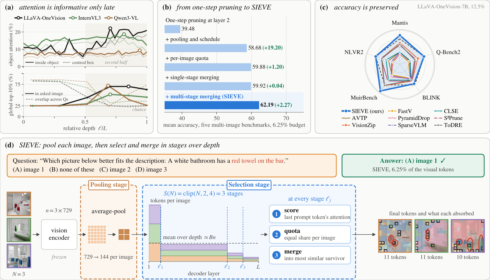
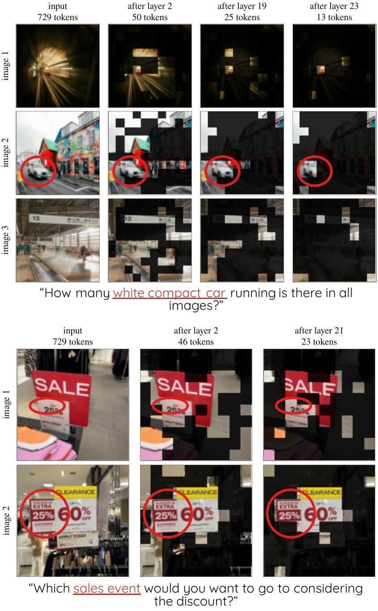
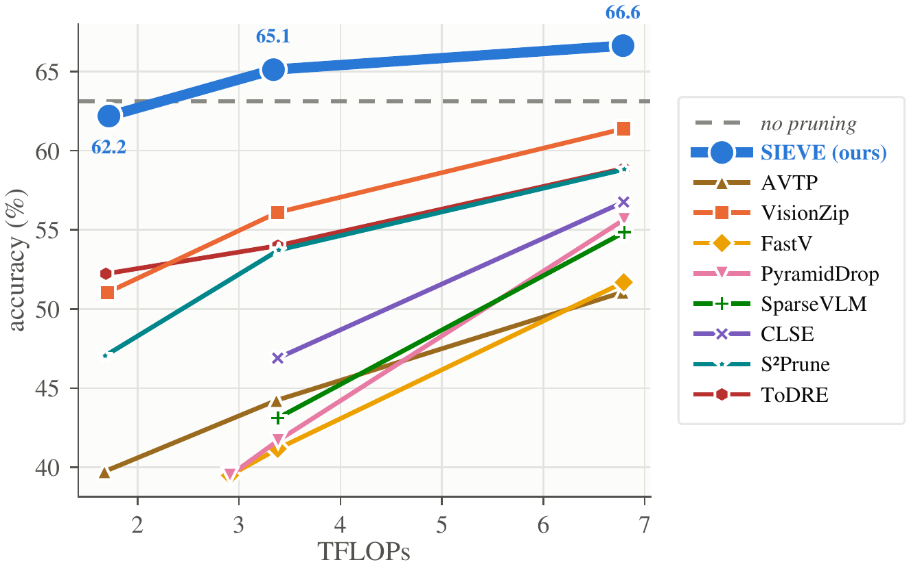

# SIEVE: Preserving Cross-Image Evidence via Depth-Aware Token Compression

SIEVE is a training-free method that compresses the visual tokens of a multi-image prompt to a fixed
budget. It pools each image before the decoder, then reduces the tokens in attention-scored stages
inside the decoder, giving every image an equal share and merging each removed token into its most
similar survivor from the same image. The number of stages follows the image count,
S(N) = clip(N, 2, 4), and a closed-form schedule makes the depth-averaged token count meet the budget.

[](https://arxiv.org/abs/2611.00351)
[](https://nitishshukla86.github.io/SIEVE/)



**Overview of SIEVE.** **(a)** **Top:** On COCO, attention to queried objects peaks in the latter half of decoder
layers across backbones. **Bottom:** Fraction of global top-10% tokens assigned to the queried image (solid) and
their overlap across questions (dashed), per backbone. Early rankings are largely query-agnostic, motivating
per-image allocation and deferred attention-based selection. **(b)** Cumulative effect of each component at a
6.25% budget, averaged over five benchmarks. Pooling and budget scheduling provide most gains; progressive merging
adds 2.27 points. **(c)** At a 12.5% budget, SIEVE leads on all five multi-image benchmarks with
LLaVA-OneVision-7B, normalized to the uncompressed model (dashed ring: 100). **(d)** Three-image example:
LLaVA-OneVision-7B answers correctly with only 6.25% of visual tokens. After per-image pooling, S(N) = 3 stages
retain equal quotas per image and merge discarded tokens into their most similar retained tokens within the same
image. Colors indicate the final token absorbing each region.

| | |
|---|---|
| **Retained visual tokens at each merging stage**, LLaVA-OneVision-7B at 6.25%. Darkened cells are no longer separate tokens. Reduction happens after layers 2, 19, 23 for the three-image question and 2, 21 for the two-image one. Red rings mark the object each question names (discount and cereal box). | **Accuracy vs. compute** on LLaVA-OneVision at B ∈ {1/16, 1/8, 1/4} (five-benchmark average). SIEVE has the highest accuracy at every compute level and, at B ≥ 1/8, exceeds the uncompressed model (dashed, 63.12). x-axis: estimated visual-token prefill TFLOPs. |
|  |  |

## Code

The code will be released soon.

## Citation

```bibtex
@article{shukla2026sieve,
  title   = {{SIEVE}: Preserving Cross-Image Evidence via Depth-Aware Token Compression},
  author  = {Shukla, Nitish and Jandial, Surgan and Bui, Nhat-Tan and Ross, Arun},
  journal = {arXiv preprint arXiv:2611.00351},
  year    = {2026}
}
```
